# admin-OS

An open-source management dashboard for small businesses, built to be operated by people and by AI assistants alike.

[](https://github.com/lroy-stack/admin-os/actions/workflows/ci.yml)
[](CHANGELOG.md)
[](package.json)
[](.nvmrc)
[](https://nextjs.org)
[](LICENSE)

**[Live demo](https://admin-os.lr0y.dev)** · [Documentation](docs/README.md) · [MCP](docs/guides/mcp.md) ·
[Changelog](CHANGELOG.md)

<p align="center">
  <picture><source media="(prefers-color-scheme: dark)" srcset="media/desktop/bookings-dark.webp">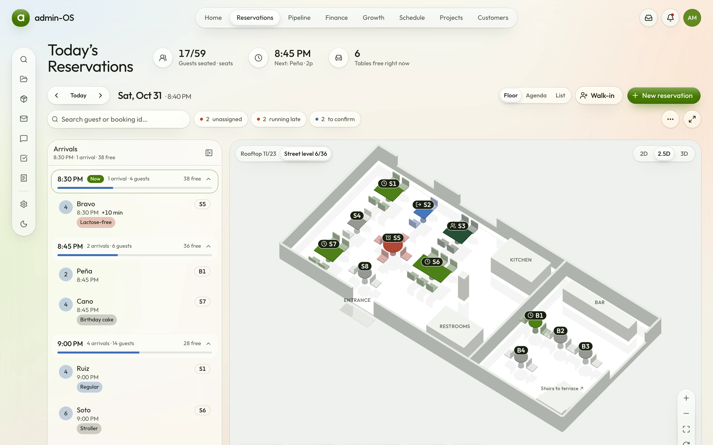</picture>
</p>

admin-OS is built for restaurants first, and a hair salon or a car repair workshop runs on the same modules through a
preset. Every screen and every MCP tool reads and writes through the same typed capabilities, so an assistant works
with exactly the data, permissions and approvals a person does. The live demo runs on Cloudflare Workers with seeded
data of its own for each visitor.

## Features

- **Bookings with a live floor plan.** The room in 2D, 2.5D or 3D, an arrivals rail by time slot, a room editor and a
  full-screen service view; status changes, walk-ins and new reservations with undo where an action can be reversed.
- **Customers.** A directory with search, a VIP filter, CSV export and a new-contact window that warns about a
  duplicate phone.
- **Business settings and invoices.** The owner sets the business details once in Settings; the invoice prints them,
  bills the customers and starts from the catalog.
- **Presets.** Hospitality, salon and workshop run the same generic modules with their own vocabulary, navigation and
  seed data.
- **Liquid-glass interface.** Five themes in light and dark, checked against WCAG contrast, on desktop, tablet and
  phone.
- **Four languages, three currencies.** English, Spanish, German and French from typed dictionaries; USD, EUR or GBP.
- **Roles, permissions and approvals.** Owner, manager and staff; a policy holds an assistant's writes for a person
  to approve.
- **MCP server.** Its own Worker over Streamable HTTP with OAuth and separate read and write grants, plus stdio for
  local clients.
- **Swappable data layer.** A mock adapter ships for the demo; a real backend implements one interface.

## Quick start

Requires Node.js 24 and npm.

```bash
git clone https://github.com/lroy-stack/admin-os.git
cd admin-os
npm install
npm run dev
```

Open <http://localhost:3000>. The [development guide](docs/guides/development.md) covers the environment, every
command, the quality gates and the Cloudflare topology.

To connect Claude Code to the live demo:

```bash
claude mcp add --transport http admin-os https://mcp.admin-os.lr0y.dev/mcp
```

## Screenshots

**Moving around.** The top bar holds the business areas, the rail the tools.

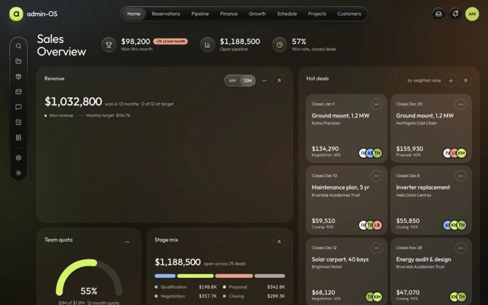

**The bookings room.** The floor plan switches between 2D, 2.5D and 3D; a table opens its booking, and the same
service reads as an agenda or a list.

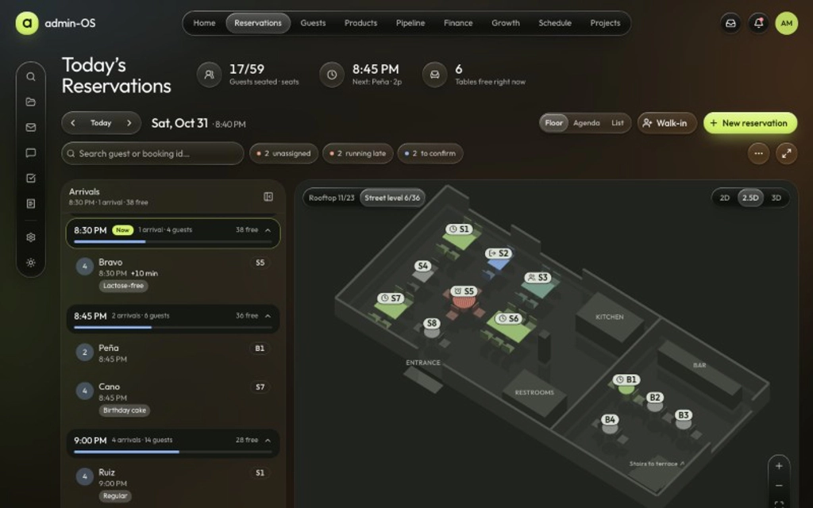

**Themes, modes and languages.**

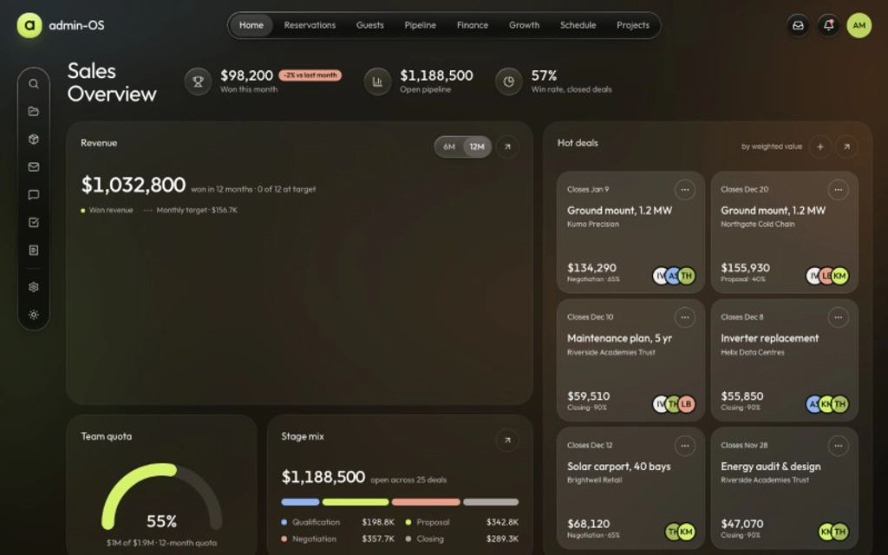

<details>
<summary>More screens: desktop, tablet and phone</summary>

Desktop, 1440 × 900. The images follow your GitHub theme.

<table>
  <tr>
    <td width="50%"><picture><source media="(prefers-color-scheme: dark)" srcset="media/desktop/home-dark.webp">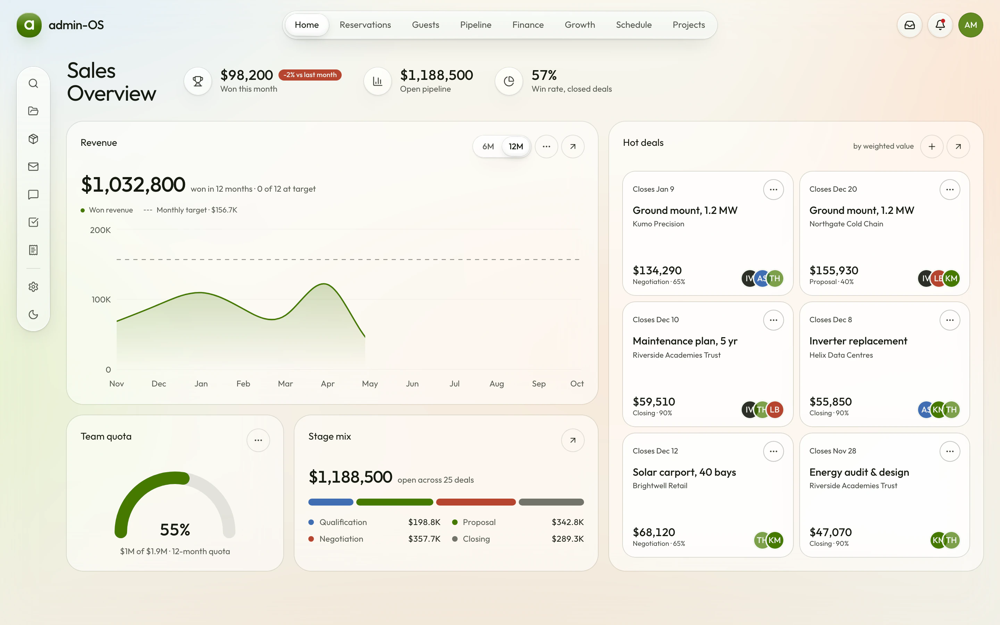</picture></td>
    <td width="50%">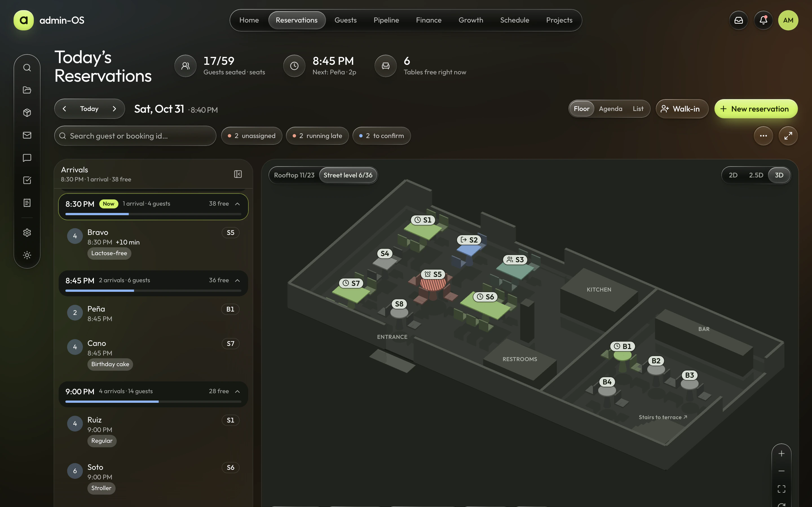</td>
  </tr>
  <tr>
    <td><picture><source media="(prefers-color-scheme: dark)" srcset="media/desktop/pipeline-dark.webp">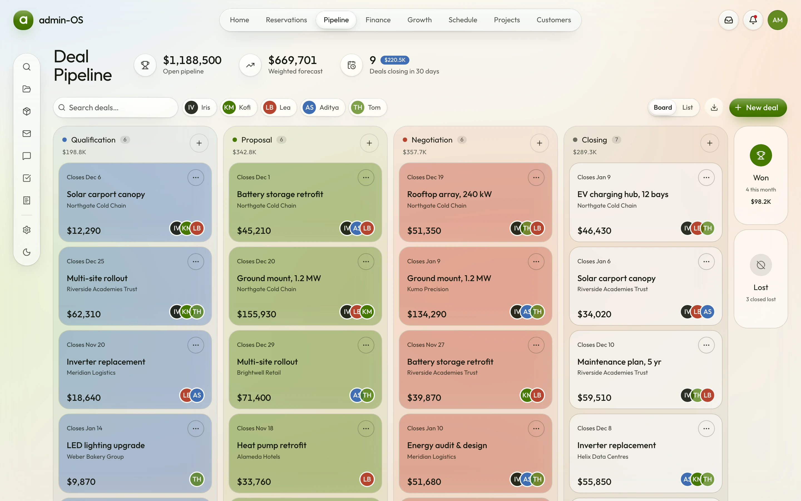</picture></td>
    <td><picture><source media="(prefers-color-scheme: dark)" srcset="media/desktop/calendar-dark.webp">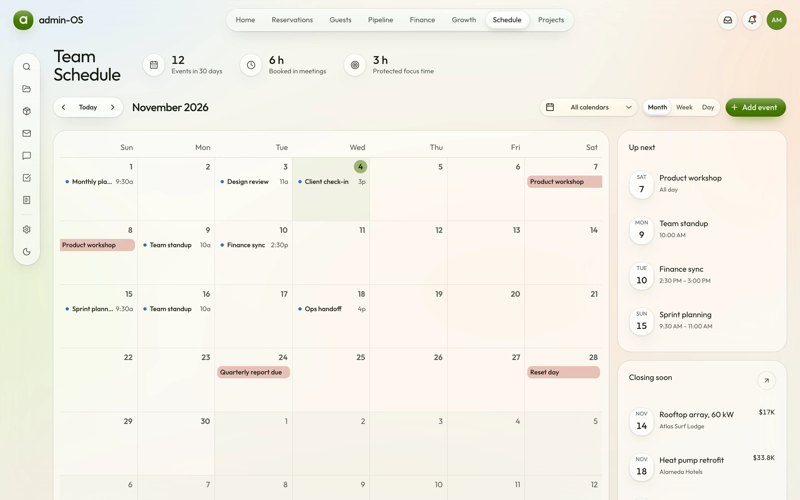</picture></td>
  </tr>
  <tr>
    <td><picture><source media="(prefers-color-scheme: dark)" srcset="media/desktop/mail-dark.webp">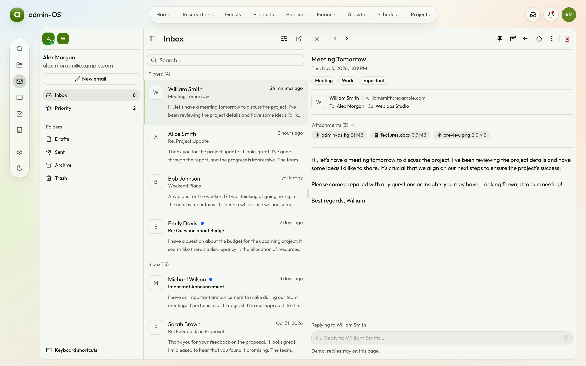</picture></td>
    <td><picture><source media="(prefers-color-scheme: dark)" srcset="media/desktop/chat-dark.webp">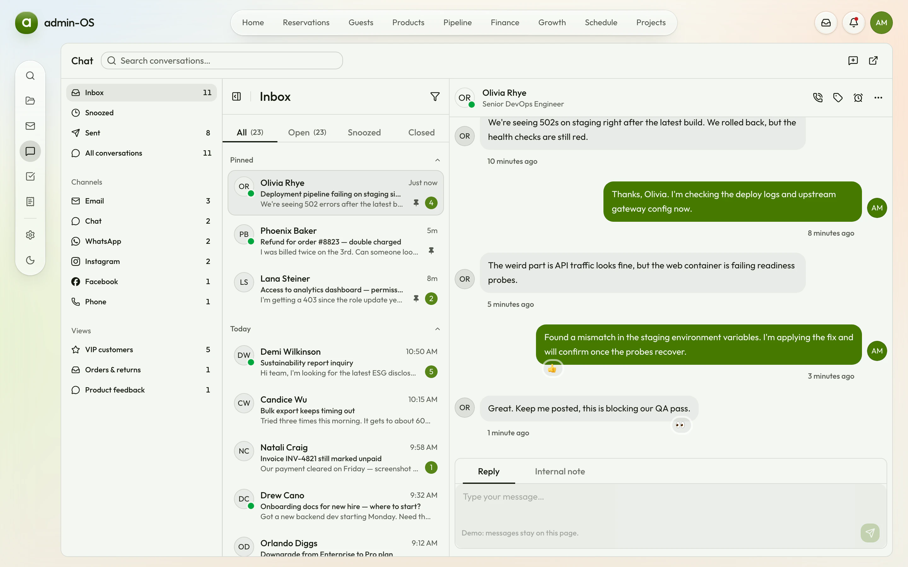</picture></td>
  </tr>
</table>

Tablet, 834 × 1194.

<table>
  <tr>
    <td width="50%"><picture><source media="(prefers-color-scheme: dark)" srcset="media/devices/tablet-bookings-dark.webp">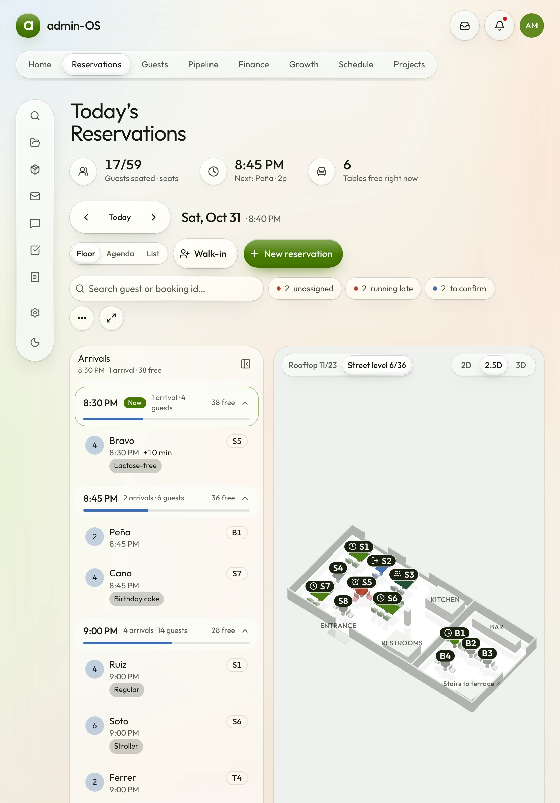</picture></td>
    <td width="50%"><picture><source media="(prefers-color-scheme: dark)" srcset="media/devices/tablet-home-dark.webp">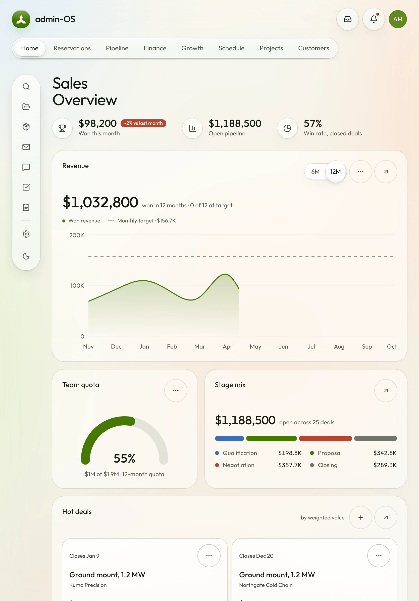</picture></td>
  </tr>
</table>

Phone, with a bottom dock and bottom sheets.

<table>
  <tr>
    <td width="33%">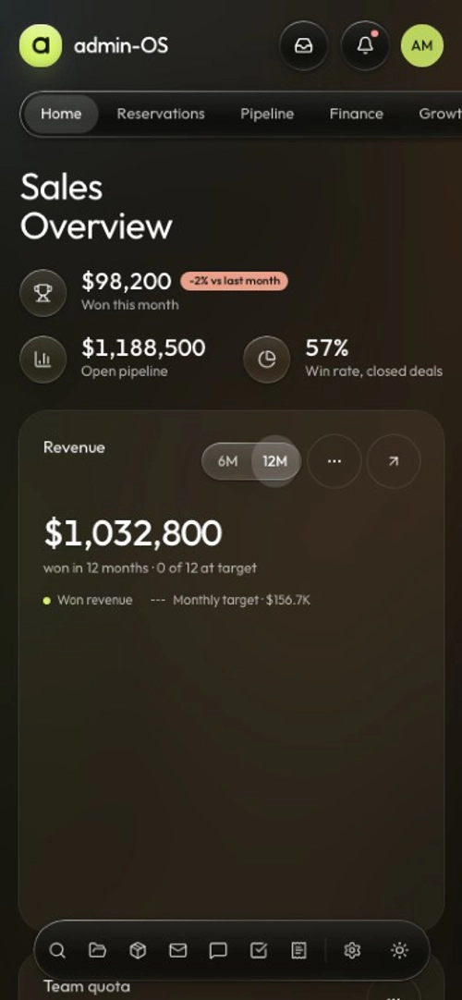</td>
    <td width="33%"><picture><source media="(prefers-color-scheme: dark)" srcset="media/devices/phone-bookings-dark.webp">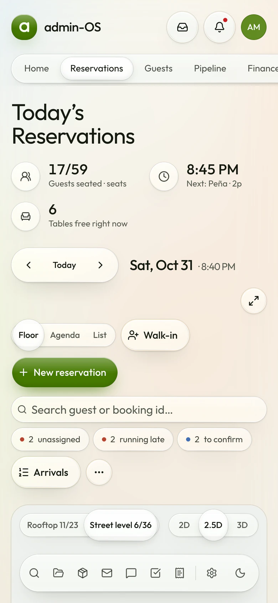</picture></td>
    <td width="33%"><picture><source media="(prefers-color-scheme: dark)" srcset="media/devices/phone-calendar-dark.webp">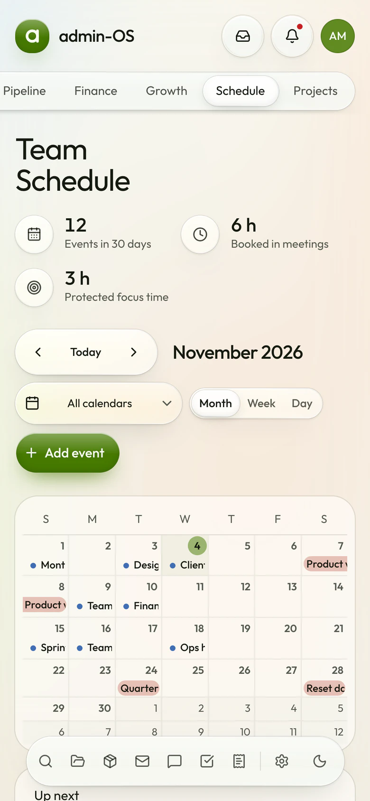</picture></td>
  </tr>
</table>

</details>

Every image is captured from the running app by `npm run media`, so it stays in step with the code.

## Documentation

| Guide | Covers |
| --- | --- |
| [Development](docs/guides/development.md) | Setup, environment, commands, quality gates, the three Workers locally |
| [Architecture](docs/guides/architecture.md) | Layers, the data seam, presets, who owns a control |
| [Building on the template](docs/guides/extending.md) | Modules, presets, controls, adapters, MCP tools |
| [Deployment](docs/guides/deployment.md) | Deploying to Cloudflare and checking a deployment |
| [MCP](docs/guides/mcp.md) | Connecting assistants, access, limits, agent evals |
| [MCP reference](docs/mcp/reference.md) | Every tool per preset and role (generated) |
| [Decision records](docs/README.md#decisions) | Why the code is the way it is |

## Tech stack

Next.js 16 (App Router, React Compiler), React 19, TypeScript, Tailwind CSS v4, shadcn/ui on Radix UI and Base UI,
TanStack Table, Zod, React Hook Form, Zustand, FullCalendar, dnd-kit, three.js and the official MCP TypeScript SDK.
Biome, dependency-cruiser, Vitest and Playwright keep it in shape; it deploys to Cloudflare Workers through OpenNext.

## Project status

The current release is [v0.2.0](CHANGELOG.md). Next is v1: the product Home, the customer record, an agenda with
layers and rooms for every preset.

## Contributing

Issues and pull requests are welcome. [`CONTRIBUTING.md`](CONTRIBUTING.md) describes the workflow and the checks a
change has to pass. To report a vulnerability, follow [`SECURITY.md`](SECURITY.md) instead of opening an issue.

## Credits

admin-OS started from [next-shadcn-admin-dashboard](https://github.com/arhamkhnz/next-shadcn-admin-dashboard) by
Mohammed Arham Khan (MIT), whose shell, screens and theme system it builds on.

## License

[MIT](LICENSE)
